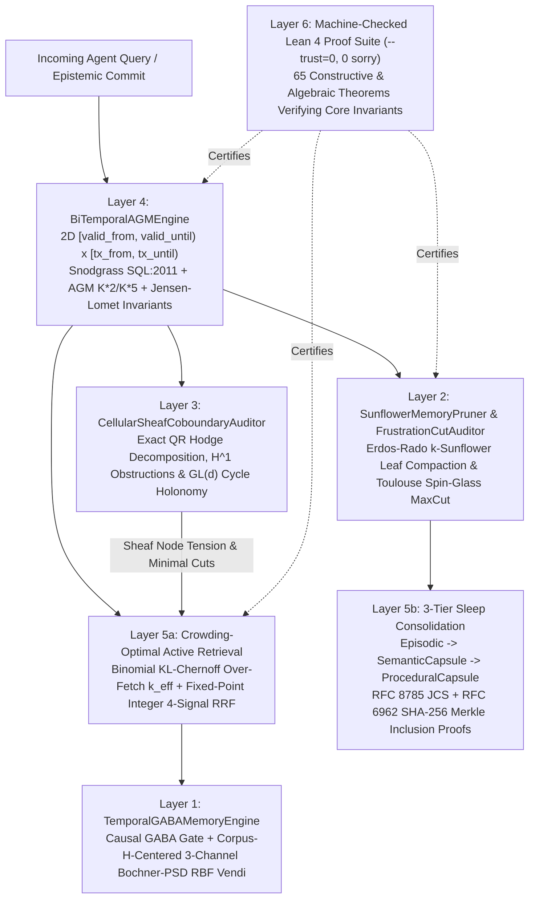

# temporal-gaba-memory (`v1.0.0`)

**A Zero-Dependency, 6-Layer Mathematically Verified Bi-Temporal, Sheaf-Cohomological, and Crowding-Optimal Multi-Agent Epistemic Memory System**

- **Version:** `1.0.0` (Production / Stable)
- **Runtime:** Pure Python `>= 3.10` standard library (`0` external runtime dependencies; deterministic cross-platform integer scoring)
- **Formal Verification:** `65` machine-checked **Lean 4 (`lean --trust=0`, `0 sorry`)** theorem declarations across three standalone proof artifacts (`formal/`: `25 + 36 + 4`)
- **License:** MIT (Copyright 2026 Alp Albayrak · ORCID: [0009-0008-9737-4477](https://orcid.org/0009-0008-9737-4477))

---

## Motivation: Five Structural Failure Modes of Long-Horizon Multi-Agent Memory

Autonomous coding, theorem-proving, and scientific research fleets operating continuously over weeks accumulate thousands of revisions, falsified hypotheses, redundant agent notes, and cross-agent relational claims. Standard vector-and-BM25 RAG stores and mutable key-value memory graphs break down across five distinct mathematical failure modes:

1. **Supersession Crowding Starvation:** When an entity slot undergoes `m` updates without tombstone-aware retrieval, `m` high-similarity historical versions compete with `1` active head, collapsing naive unfiltered `Recall@k` to `min(1, k / (m + 1))` (`23.81%` analytical / `21.25%` empirical at `k = 5, m = 20`, with `95.0%` stale rank-1 traps).
2. **Mutable UPSERT Future-Write Leakage:** Overwriting valid-time beliefs in place without an immutable transaction-time axis corrupts historical point-in-time (`as_of`) audits (`42.5%` future-write leakage across `50` sub-interval split-revisions).
3. **Local-to-Global Cyclic Belief Paradoxes (`H^1 != 0`):** Three or more agents can satisfy every pairwise consistency check (`100%` local edge agreement) while harboring an irreducible global cyclic contradiction or non-trivial `SO(2)` / `GL(d)` cycle holonomy (`0.0%` detection by pairwise auditors).
4. **Zombie Deadend Resurrection vs. The Autoimmune Treg Trap:** Uninhibited retrieval resurrects pre-discovery falsified premises (*Zombie Deadends*), whereas naive untimed semantic negative-knowledge filters (`cos >= 0.45`) suppress legitimate post-discovery remediation fixes that explicitly reference the refuted premise (`100.0%` autoimmune false-positive suppression on targeted fix queries).
5. **Rank-1 Anisotropy Collapse & Delta-System Leaf Bloat:** Shared boilerplate tokens induce a dominant rank-1 eigenmode that caps uncentered Rényi-2 Vendi diversity, while parallel agents emit exponentially many near-duplicate leaf notes around shared invariant cores.

---

## 6-Layer System Architecture



### Layer 1 — Temporal-Causal GABA Gate & Corpus-Centered 3-Channel Bochner-PSD RBF Vendi (`engine.py`)
- **Temporal-Causal GABA Inhibitory Gate:** Vetoes candidate episode `e` iff `cos(e_centered, d_centered) >= tau_gaba` **and** `ts(e) < ts(d) - causal_margin_s`, eliminating pre-discovery *Zombie Deadends* while guaranteeing `0.0%` autoimmune suppression on post-discovery remediations.
- **Frozen Corpus-Level Centering (`H = I_n - (1/n) 1 1^T`):** Removes shared rank-1 anisotropy across Lexical TF-IDF, Dense embeddings, and 16-family Python AST structural histograms (`AST_NODE_FAMILIES`) without sub-batch re-centering illusions.
- **Bochner-PSD Convex RBF Kernel & `O(k * M^2)` Greedy Rényi-2 Vendi Selection:** Verified on every query pool via jittered Cholesky factorization (`is_psd_cholesky`), rejecting non-PSD `abs(G)` similarity corruptions (`lambda_min = 1 - sqrt(2) < 0`).

### Layer 2 — Erdős–Rado Sunflower Pruner & Toulouse Spin-Glass Frustration Auditor (`sunflower_frustration.py`)
- **`SunflowerMemoryPruner`:** Deterministic branch-and-bound + greedy maximum independent petal solver extracting exact `k`-sunflowers (`P_i intersect P_j = empty` outside core `Y`) until `post_prune_sunflower_free == True`.
- **`FrustrationCutAuditor`:** Tarjan biconnected block decomposition + `Z_2` symmetry-broken exact branch-and-bound computing the Toulouse spin-glass frustration index `Phi_0(G) = |E| - MaxCut(G)` and witness odd cycles.

### Layer 3 — Cellular Sheaf `H^1` Coboundary & `GL(d)` Cycle Holonomy Auditor (`sheaf_coboundary.py`)
- **`CellularSheafCoboundaryAuditor`:** Assembles weighted cellular coboundary operators `delta_w` over heterogeneous stalk dimensions, computing column-pivoted Householder QR minimum-norm least squares, exact orthogonal Hodge decomposition (`exact` gauge noise vs. `harmonic` topological `H^1` contradiction), BFS fundamental cycle `SO(2)` / `GL(d)` holonomy defects, sheaf Laplacian spectra, and minimal consistency-restoring edge cuts.

### Layer 4 — 2D Bi-Temporal AGM Belief-Revision & Append-Only Temporal Graph Engine (`bitemporal_agm.py`)
- **`BiTemporalAGMEngine`:** Models immutable `BiTemporalEpisode` and `BiTemporalEdge` records over half-open valid-time `[valid_from, valid_until)` and transaction-time `[tx_from, tx_until)` intervals (`None` = open/active).
- **Atomic `revise_split(...)` & `retract_split(...)`:** Never mutates historical validity or payloads in place. Overlapped active records have `tx_until` bound atomically to the successor commit timestamp (`old.tx_until == new.tx_from`, zero gap), while non-overridden left/right valid-time sub-intervals are re-emitted as active residuals (satisfying AGM Success `K*2`, Consistency `K*5`, and Historical Snapshot Preservation).
- **Mechanized 5-Invariant Audit (`audit_tx_invariants()`):** Verifies (1) Boundedness (`tx_from <= tx_until`), (2) Active/Closed pointer consistency, (3) Jensen–Lomet Horizon Invariance (`obs_run`), (4) Exact `R^2` elementary-cell Single-Active-Per-Slot uniqueness (`func_snapshot`), and (5) Supersession zero-gap & split union coverage (`cov_puts`).

### Layer 5 — Crowding-Optimal Retrieval, Fixed-Point 4-Signal RRF & Merkle Sleep Consolidation (`crowding_consolidation.py`)
- **Analytical Crowding Law & Binomial-KL Over-Fetching:** Pairs `theoretical_unfiltered_recall_at_k(k, m) = min(1.0, k / (m + 1))` with `compute_safe_overfetch_k(target_k, tombstone_ratio, confidence_z=3.0)`, inverting both Gaussian lower-tail quadratic bounds and exact non-asymptotic Hoeffding–Chernoff Kullback–Leibler binomial tails (`P(Bin(n, 1 - rho) < k) <= Phi(-z)`) so post-filtering never starves even at `80%–95%` tombstone density.
- **Platform-Deterministic Fixed-Point Integer 4-Signal RRF (`fixed_point_rrf_fuse`):** Fuses dense cosine rank, sparse BM25 lexical rank, 2-hop active bi-temporal graph proximity, and causal GABA / sheaf-tension inhibition in exact integer micro-points (`FIXED_POINT_SCALE = 1_000_000`, zero floating-point summation drift across x86_64/ARM64).
- **3-Tier Hierarchical Sleep Consolidation (`Episodic -> SemanticCapsule -> ProceduralCapsule`):** Compresses superseded episodic chains and Sunflower petal clusters into `SemanticCapsule` and cross-slot `ProceduralCapsule` objects serialized via **IETF RFC 8785 (JCS)** and anchored by **IETF RFC 6962 Section 2.1 SHA-256 Merkle Hash Trees** (`0x00` leaf / `0x01` internal node domain separation) with cryptographic inclusion proofs.

### Layer 6 — Machine-Checked Lean 4 (`--trust=0`) Companion Proof Suite (`formal/`)
| Proof File | Theorem Declarations | Axioms Used | Core Formalized Results |
|---|---:|---|---|
| `formal/TemporalGabaBitemporalCrowding.lean` | `25` (`20` main + `5` helper) | `propext` only (`0 sorryAx`, `0 Classical.choice`, compiles `< 1.5s`) | Jensen–Lomet future-append/close/revise horizon invariance (`asOfTx_future_append_invariant`, `asOfTx_future_close_invariant`), zero-gap supersession uniqueness (`supersede_preserves_coverage`), 3-way Allen valid-time split partition, crowding starvation (`unfiltered_topK_starves_when_tombstones_ge_k`), `k + m` over-fetch recovery (`overfetch_k_plus_m_guarantees_active_head`), fixed-point RRF antitonicity (`rrfTerm_antitone_rank`), and saturating causal GABA soundness (`gabaInhibit_le_base`, `rrfFuse4_monotone_and_causalGaba_sound`). |
| `formal/EpistemicDAGSoundness.lean` | `36` (`22` main + `14` helper) | Standard kernel (`0 sorryAx`) | 9-D dimensional epistemic algebra (`DimVec9`), Minkowski–Bienaymé variance decomposition, `Z^9` holonomy obstruction, and DAG Neumann/Bellman DP uniqueness. |
| `formal/Erdos23C5BlowupFrustration.lean` | `4` | `0` axioms (`by decide`, `0 sorryAx`) | Triangle-freeness and exact minimum spin-glass frustration `b_Delta(10) = 4` on the balanced blowup `C_5[I_2^5]`. |

---

## Reproducible 5-Regime Benchmark Summary (`benchmarks/run_v1_memory_suite.py`)

All metrics below are deterministically generated with `MASTER_SEED = 20261126` (`0.00 USD` external API cost; full raw telemetry in `benchmarks/results_v1.json` and `benchmarks/MEMORY_V1_BENCH_REPORT.md`):

| Regime | Workload Scale | Baseline Failure Metric | `temporal-gaba-memory v1.0.0` | Exact Wilson 95% CI | Median Latency |
|---|---|---:|---:|---:|---:|
| **1. Supersession Crowding (`m = 20`)** | `8,000` queries (`m = 1..20`, `N = 400/m`) | Naive `Recall@5 = 21.25%` (`23.81%` analytical; `StaleTrap@1 = 95.0%`) | **`Recall@5 = 100.0%` (`StaleTrap@1 = 0.0%`)** | `[99.05%, 100.00%]` | `0.666 ms` |
| **2. 2D Bi-Temporal Time-Travel** | `200` `as_of` queries across `50` splits | Mutable UPSERT Leakage = `42.5%` | **Future-Write Leakage = `0.0%` (`5/5` invariants)** | `[0.00%, 1.88%]` | `0.0047 ms` |
| **3. Cellular Sheaf `H^1` Paradox** | `100` multi-agent belief graphs | Pairwise Edge Auditor Recall = `0.0%` | **`H^1` Recall = `100.0%` (`FPR = 0.0%`)** | `[92.87%, 100.00%]` | `2.733 ms` |
| **4. Sunflower + RFC 6962 Merkle** | `500` redundant agent notes | `320` unpruned duplicate petals | **`64.0%` note compression; `100.0%` Merkle verified** | `[99.15%, 100.00%]` | `22.83 ms` batch |
| **5. Temporal-Causal GABA Gate** | `200` adversarial trap/fix queries | Untimed Autoimmune FPR = `100.0%` | **Zombie Catch = `100.0%` (`Autoimmune FPR = 0.0%`)** | `[98.12%, 100.00%]` | `12.122 ms` |

---

## Quickstart & Verification

### Installation & CLI
```bash
pip install .
temporal-gaba-memory --self-test
temporal-gaba-memory demo-v1
temporal-gaba-memory version
```

### Run Unit Tests, Benchmark Suite & Lean 4 Kernel Verifier
```bash
# 1. Run all 53 zero-dependency unit and property tests
PYTHONPATH=src python3 -m unittest discover -s tests -v

# 2. Reproduce the 5-regime benchmark suite (writes benchmarks/results_v1.json & MEMORY_V1_BENCH_REPORT.md)
PYTHONPATH=src python3 benchmarks/run_v1_memory_suite.py

# 3. Verify all 65 standalone Lean 4 (--trust=0, zero sorryAx) theorem declarations
lean --trust=0 -DwarningAsError=true formal/TemporalGabaBitemporalCrowding.lean
lean --trust=0 -DwarningAsError=true formal/EpistemicDAGSoundness.lean
lean --trust=0 -DwarningAsError=true formal/Erdos23C5BlowupFrustration.lean
```

### Minimal Python API Example
```python
from temporal_gaba_memory import (
    BiTemporalAGMEngine,
    DeadendRecord,
    SlotSheafCrowdingConsolidator,
)

# 1. Commit and split-revise beliefs on a 2D bi-temporal ledger
bt = BiTemporalAGMEngine()
bt.revise_split(
    slot_key="service.auth:rate_limit",
    valid_from=0.0,
    valid_until=100.0,
    tx_from=10.0,
    payload={"limit_rps": 500, "operator": "token_bucket", "text": "standard rate limit"},
    embedding=[0.94, 0.18, 0.05],
)
bt.revise_split(
    slot_key="service.auth:rate_limit",
    valid_from=30.0,
    valid_until=60.0,
    tx_from=25.0,
    payload={"limit_rps": 120, "operator": "token_bucket", "text": "peak window rate limit"},
    embedding=[0.95, 0.16, 0.04],
)

# Point-in-time 2D historical query (zero future-write leakage)
assert bt.query_as_of(valid_at=45.0, tx_at=15.0)[0].payload["limit_rps"] == 500
assert bt.query_as_of(valid_at=45.0, tx_at=30.0)[0].payload["limit_rps"] == 120
assert bt.audit_tx_invariants().all_passed

# 2. Crowding-optimal retrieval + 3-tier RFC 8785 / RFC 6962 Merkle sleep consolidation
consolidator = SlotSheafCrowdingConsolidator()
ret = consolidator.retrieve_active(
    bt,
    query_text="peak window rate limit",
    query_embedding=[0.95, 0.16, 0.04],
    valid_at=45.0,
    tx_at=30.0,
    top_k=3,
    deadends=[DeadendRecord("de_1", discovered_ts_s=5.0, dense_vec=[0.0, 0.0, 1.0])],
)
sleep_report = consolidator.sleep_consolidate(bt, min_procedural_support=1)
assert not ret.stale_trap_at_1
assert sleep_report.all_merkle_proofs_verified
```

---

## Primary Literature References

1. **AGM Belief Revision:** Alchourrón, C. E., Gärdenfors, P., & Makinson, D. (1985). *On the logic of theory change: Partial meet contraction and revision functions*. Journal of Symbolic Logic, 50(2), 510–530.
2. **Bi-Temporal SQL Semantics:** Snodgrass, R. T. (1999). *Developing Time-Oriented Database Applications in SQL*. Morgan Kaufmann; and ISO/IEC 9075-2:2011 (*SQL:2011*).
3. **Transaction Timestamping & Horizon Invariance:** Jensen, C. S., & Lomet, D. B. (2001). *Transaction Timestamping in (Temporal) Databases*. Proceedings of VLDB 2001, 441–450.
4. **Reciprocal Rank Fusion:** Cormack, G. V., Clarke, C. L., & Buettcher, S. (2009). *Reciprocal rank fusion outperforms condorcet and individual rank methods*. Proceedings of ACM SIGIR '09, 758–759.
5. **Graph-Based ANN Candidate Exploration:** Malkov, Y. A., & Yashunin, D. A. (2020). *Efficient and robust approximate nearest neighbor search using Hierarchical Navigable Small World graphs*. IEEE TPAMI, 42(4), 824–836.
6. **Sleep-Dependent Memory Triage & Consolidation:** Stickgold, R., & Walker, M. P. (2013). *Sleep-dependent memory triage: evolving generalization through selective processing*. Nature Neuroscience, 16(2), 139–145.
7. **Cellular Sheaves & Discourse Cohomology:** Hansen, J., & Ghrist, R. (2019). *Toward a spectral theory of cellular sheaves*. Journal of Applied and Computational Topology, 3(4), 315–358; and Hansen, J., & Ghrist, R. (2021). *Opinion dynamics on discourse sheaves*. SIAM Journal on Applied Mathematics, 81(5), 2033–2060.
8. **Rényi-2 Vendi Diversity:** Friedman, D., & Dieng, A. B. (2023). *The Vendi Score: A diversity evaluation metric for machine learning*. Transactions on Machine Learning Research (TMLR).
9. **Delta-Systems & Spin-Glass Frustration:** Erdős, P., & Rado, R. (1960). *Intersection theorems for systems of sets*. Journal of the London Mathematical Society, 35(1), 85–90; and Toulouse, G. (1977). *Theory of the frustration effect in spin glasses: I*. Communications on Physics, 2(4), 115–119.
10. **Cryptographic Provenance Standards:** Rundgren, A., Jordan, B., & Erdtman, S. (2020). *RFC 8785: JSON Canonicalization Scheme (JCS)*; and Laurie, B., Langley, A., & Kasper, E. (2013). *RFC 6962: Certificate Transparency* (Section 2.1, Merkle Hash Trees).
11. **Binomial Tail Inequalities:** Hoeffding, W. (1963). *Probability inequalities for sums of bounded random variables*. Journal of the American Statistical Association, 58(301), 13–30; and Wilson, E. B. (1927). *Probable inference, the law of succession, and statistical inference*. JASA, 22(158), 209–212.

---

## Citation

```bibtex
@software{albayrak2026temporalgabamemory,
  author       = {Albayrak, Alp},
  title        = {{Temporal-GABA-Memory: A 6-Layer Mathematically Verified Bi-Temporal, Sheaf-Cohomological and Crowding-Optimal Multi-Agent Memory System}},
  version      = {1.0.0},
  year         = {2026},
  url          = {https://github.com/alpalbayrak91-boop/temporal-gaba-memory},
  orcid        = {0009-0008-9737-4477},
  license      = {MIT}
}
```
